# AWS Storage and Databases: S3 Website, Private Data, RDS and DynamoDB


**Exercise date:** week of 24 August 2026 | **Type:** Davine Technologies Internship Project, AWS Cloud internship week 4 lab | **Status:** rebuilt as tested Terraform; applied in two stages, verified and destroyed on 16 November 2026

[](https://github.com/ooseni/davine-week4-aws-storage-databases/actions/workflows/ci.yml)

> **Evaluation project.** A learning task completed for the Davine Technologies internship programme, rebuilt for this repository in my own AWS account. Every resource existed only for the length of a test run, and all data in it is synthetic. It is not a production setup and contains no company data.

**At a glance**

- **Outcome:** a static website served straight from Amazon S3, a private store for the business's files that can undo a mistaken overwrite or delete, and two databases, each chosen for its kind of data. A review I scripted found that the first version let anyone on the internet download every uploaded file. The fix closed that, and I proved it live.
- **Built:** Terraform in two stages, the weekly task as first built (`baseline`) and the result of the review (`hardened`); a storage review script, [`storage_review.py`](scripts/storage_review.py); live verification and teardown scripts; a [concepts report](docs/report.md) ([PDF](docs/report.pdf)); an [implementation guide](docs/implementation.md) with the decisions; an [AI assistant log](docs/ai-architecture-assistant.md).
- **Stack:** Terraform 1.17 (AWS provider 6.73), Amazon S3 (static website hosting, Block Public Access, bucket policies, versioning, lifecycle rules, storage classes), Amazon RDS for PostgreSQL 17, Amazon DynamoDB, Amazon VPC, AWS Secrets Manager, AWS CLI v2, Bash, Python 3, ShellCheck, TFLint, Checkov, Trivy, gitleaks, GitHub Actions.
- **Proof:** on 16 November 2026, **119 of 119 live checks passed** across the two stages. In the baseline, a request with no credentials downloaded a customer CSV (HTTP 200). After the fix, the same request got 404 and 403, and a file I overwrote and deleted came back from its versions with the same checksum. **25 Terraform, 39 review-script and 16 redaction tests pass on every push.** Everything was destroyed the same day, at an estimated cost of about US$0.05, and a search by name found nothing left.

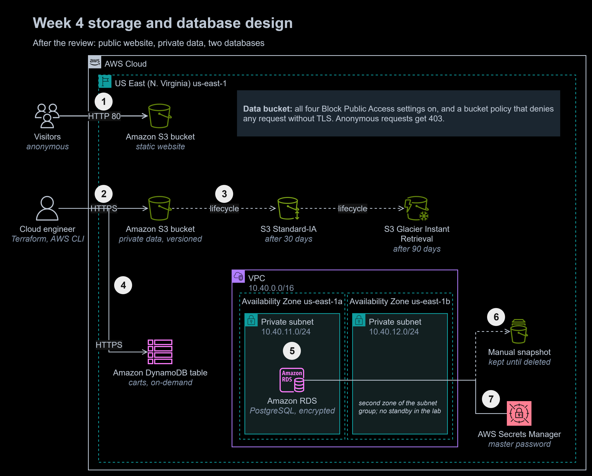

To zoom in, right-click the diagram and open the image in a new tab. The editable source is [`docs/diagrams/storage-architecture.drawio`](docs/diagrams/storage-architecture.drawio).

1. **Visitors** load the website over HTTP from the **website bucket**. Its policy lets anyone read its objects, and nothing else: list, upload and delete are refused.
2. The **cloud engineer** reaches the **data bucket** over HTTPS only. All four Block Public Access settings are on, and the bucket policy refuses any request without TLS.
3. **Lifecycle rules** move documents to **S3 Standard-IA** after 30 days and **S3 Glacier Instant Retrieval** after 90, expire logs after a year, and delete old versions after 30 days.
4. Shopping carts live in an on-demand **Amazon DynamoDB table** with point-in-time recovery, and TTL removes abandoned carts.
5. Orders live in **Amazon RDS for PostgreSQL** in two private subnets of a VPC with no internet gateway. Its security group accepts port 5432 from the application security group only.
6. A **manual snapshot** of the database is kept until someone deletes it, so it survives the database itself being deleted.
7. RDS created the master password and keeps it in **AWS Secrets Manager**. It never appears in my code or my Terraform state.

## The task, in my own words

Learn the AWS storage and database services and when to use each one. Then, hands on:
- create an S3 bucket, upload files into folders, set its permissions and turn on static website hosting;
- try the different storage classes;
- create an RDS database and a DynamoDB table;
- explain S3, its storage classes, bucket policies, EBS, EFS, RDS, DynamoDB and storage security in a short PDF.

Then act as the cloud engineer for a growing application:
- review that same setup and its access configuration;
- compare S3, EBS and EFS, and RDS and DynamoDB, for real requirements;
- take backups or snapshots where they apply;
- find one security or reliability improvement, make it and prove it worked;
- draw the final design and explain the decisions.

Finally, use an AI assistant as an architecture adviser and verify at least one of its recommendations in AWS.

## What I did in the internship, and what this repository is

I completed this week in August 2026 in the AWS console and submitted a report and screenshots to the programme. I did not keep copies, so for this repository I rebuilt the whole week as Terraform and scripts and ran it again on 16 November 2026. Every screenshot and transcript here comes from that run, and the commit dates are the real dates of this rebuild.

## The rebuilt solution

| Path | What it holds |
|---|---|
| [`terraform/`](terraform) | the buckets, website and uploads ([`s3.tf`](terraform/s3.tf)), the database VPC ([`network.tf`](terraform/network.tf)), RDS ([`rds.tf`](terraform/rds.tf)), DynamoDB ([`dynamodb.tf`](terraform/dynamodb.tf)), the website ([`site/`](terraform/site)), synthetic uploads ([`sample-data/`](terraform/sample-data)) and 25 tests ([`tests/`](terraform/tests/storage.tftest.hcl)) |
| [`scripts/`](scripts) | the review [`storage_review.py`](scripts/storage_review.py); live scripts [`verify_live.sh`](scripts/verify_live.sh) and [`teardown.sh`](scripts/teardown.sh), and their shared [`lib.sh`](scripts/lib.sh) |
| [`tests/`](tests) | the review script's unit tests and its baseline and hardened fixtures, and the redaction tests |
| [`docs/`](docs) | [report](docs/report.md), [implementation and decisions](docs/implementation.md), [testing](docs/testing.md), [AI assistant](docs/ai-architecture-assistant.md), [live transcripts](docs/evidence) |
| [`screenshots/`](screenshots) | redacted console evidence, before and after |

**What the brief asked for, and where it is:**

| Brief | Done by | Evidence |
|---|---|---|
| Create an S3 bucket | `aws_s3_bucket.site`, with a random suffix for a unique name | [bucket list](screenshots/04-s3-buckets.png) |
| Upload and organise files into folders | five synthetic files under `documents/`, `images/`, `logs/`, `backups/` | [before](screenshots/01-before-site-bucket-objects.png), [after](screenshots/08-data-bucket-folders.png) |
| Configure permissions and access | ACLs off; Block Public Access; bucket policies | [before](screenshots/02b-before-public-read-policy.png), [after](screenshots/10b-data-tls-only-policy.png) |
| Enable static website hosting | index and custom error documents | [console setting](screenshots/06e-site-static-website-hosting.png), [the live site](screenshots/07-static-website.png) |
| Explore S3 storage classes | a different class per folder, plus lifecycle rules | [Glacier Instant Retrieval](screenshots/09-backups-glacier-instant-retrieval.png), [lifecycle rules](screenshots/12-data-lifecycle-rules.png), [report §2](docs/report.md#2-s3-storage-classes) |
| Create an RDS instance | PostgreSQL 17, db.t4g.micro, private, encrypted | [connectivity](screenshots/13-rds-connectivity.png), [maintenance](screenshots/14-rds-maintenance.png) |
| Create a DynamoDB table | `davine-wk4-carts`, on-demand, three sample items | [table](screenshots/16-dynamodb-table.png), [items](screenshots/17-dynamodb-items.png) |
| EBS and EFS use cases | explained and compared with S3 | [report §4 and §5](docs/report.md#4-amazon-ebs) |
| A short PDF on eight topics | the report | [report.md](docs/report.md), [report.pdf](docs/report.pdf) |
| Review the bucket and its access | `storage_review.py` on the live baseline: 1 high, 4 medium, 1 low | [baseline transcript](docs/evidence/verify-baseline-2026-11-16.txt) |
| Compare S3, EBS, EFS and RDS, DynamoDB | side-by-side tables for one online shop | [report](docs/report.md#s3-ebs-and-efs-side-by-side), [AI log](docs/ai-architecture-assistant.md) |
| Backup or snapshot | RDS manual snapshot, DynamoDB backup, S3 versioning | [RDS snapshot](screenshots/15-rds-manual-snapshot.png), [DynamoDB backups](screenshots/18-dynamodb-backups.png) |
| One improvement, made and verified | private data moved to its own locked, versioned, TLS-only bucket | [before and after](#before-and-after), [hardened transcript](docs/evidence/verify-hardened-2026-11-16.txt) |
| Final architecture diagram | [`storage-architecture.drawio`](docs/diagrams/storage-architecture.drawio) | above |
| Document the decision and why | [Decisions](#decisions) below, in full in the implementation guide | [implementation.md](docs/implementation.md#part-2-the-hands-on-review-stage-hardened) |
| AI as an architecture assistant | its comparisons and review; four recommendations verified | [ai-architecture-assistant.md](docs/ai-architecture-assistant.md) |

### Decisions

- **Public content and private data never share a bucket.** A public-read policy on `bucket/*` covers every object, so anything uploaded beside the website is public the moment it lands. Narrowing the policy to a prefix would also stop the leak, but the private files would then depend on one line of JSON staying right, and Block Public Access could never be turned on. A second bucket can have it fully on.
- **The private bucket is versioned and TLS-only.** Versioning makes an overwrite or delete reversible; an expiry on old versions keeps the cost bounded.
- **Each folder gets the storage class its use calls for:** Standard for documents read often, Intelligent-Tiering for images with unknown access, Standard-IA for logs read rarely, Glacier Instant Retrieval for backups that must still restore at once.
- **Orders go to RDS, carts to DynamoDB.** Orders reference customers and their totals must add up inside a transaction, which is relational work. A cart is always read by one key, its traffic is spiky, and an abandoned one should vanish on its own.
- **EBS and EFS were not created on their own.** Nothing here needs a disk for one server or a directory shared by many. EBS still sits under the database, as the gp3 volume RDS manages.
- **Backups are taken where they apply:** 7 days of automated RDS backups plus a manual snapshot, DynamoDB point-in-time recovery plus an on-demand backup, S3 versioning for files.

### Running it

```bash
aws sso login --profile <admin-profile> && export AWS_PROFILE=<admin-profile>
cd terraform && terraform init
terraform apply -var stage=baseline && cd ..    # 32 resources, about 9 minutes (RDS is the slow one)
scripts/verify_live.sh                           # 52 checks; records the finding
terraform -chdir=terraform apply                 # the fix: 13 added, 5 destroyed
scripts/verify_live.sh                           # 67 checks, including the recovery drill
scripts/teardown.sh                              # destroy, then search for anything left
```

The RDS instance costs about US$0.02 an hour while it exists; S3, DynamoDB and the VPC cost next to nothing at this size. The full walkthrough is in [docs/implementation.md](docs/implementation.md).

## How it is tested

**Tested on every push** by GitHub Actions, with no AWS credentials, each tool in a pinned Docker image:
- **actionlint** checks the workflow file itself;
- **39 of 39** review-script tests pass;
- **ShellCheck** reports 0 findings in the 4 scripts;
- **16 of 16** redaction tests pass;
- a guard fails the build if a database password is ever set in Terraform;
- Terraform format and validate pass, and **25 of 25 Terraform tests** pass against a mocked provider;
- **TFLint** reports 0 issues;
- **Checkov** passes 59 checks, with 26 skips, each with a written reason;
- **Trivy** reports 0 findings, with 11 ignores, each with a written reason;
- **gitleaks** finds no secrets in the history.

To prove the tests catch real mistakes, I broke a copy of the Terraform five ways: the database made public, the website policy widened to `s3:*`, one Block Public Access setting turned off, point-in-time recovery turned off, and the database rule opened to the whole VPC range. Each break failed exactly one test.

**Tested live on AWS** on 16 November 2026: **119 passed, 0 failed.**
- **Baseline (52):** the website returns 200 as `text/html` and its custom 404 page; anonymous list, upload and delete get 403; each file has its storage class. The finding: `documents/customer-export.csv` downloads with no credentials (HTTP 200), and the review exits 1. RDS is available, private, encrypted, keeps 7 days of backups and has one inbound rule; its endpoint resolves to `10.40.x.x` and does not answer from the internet. DynamoDB passes a query, a consistent read, a refused conditional overwrite and an atomic counter.
- **Hardened (67):** the same file now gets 404 from the website and 403 from the data bucket; Block Public Access is fully on and `IsPublic` is false; a signed request is refused over plain HTTP and allowed over HTTPS. The **recovery drill** overwrote a file, deleted it (404), then restored the original with the same checksum and version ID. The manual RDS snapshot and the DynamoDB backup are available, and the review exits 0 with nothing to fix.
- **Teardown (11):** `terraform destroy` removed all 40 resources, then the script searched by name for every kind of resource the lab made. The first search, a minute after the destroy, still found one RDS snapshot. Nine minutes later RDS had removed it on its own, and the second search passed 11 of 11.

Details, including the first hardened run that failed, are in [docs/testing.md](docs/testing.md).

## Screenshots

From the 16 November 2026 run, with the account name, account ID and ARNs blacked out.

### Before and after

**Before:** the uploaded folders sat in the website bucket, under a policy that lets anyone read every object.

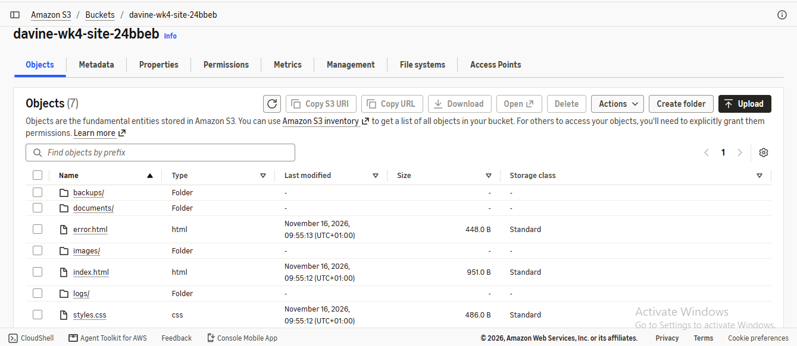

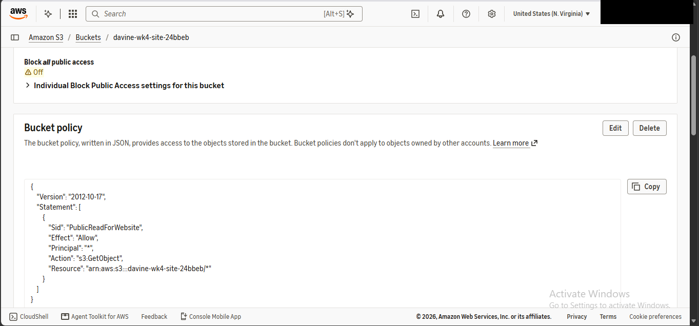

**After:** the folders live in their own bucket, with Block Public Access on, a TLS-only policy and versioning.

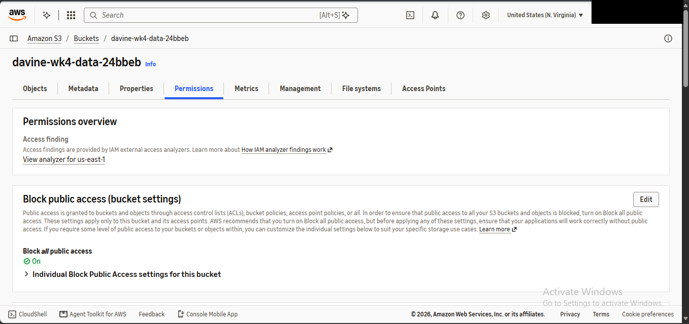

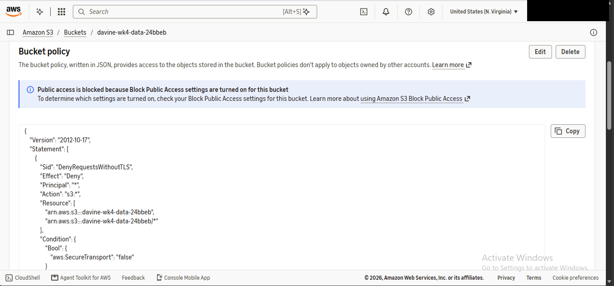

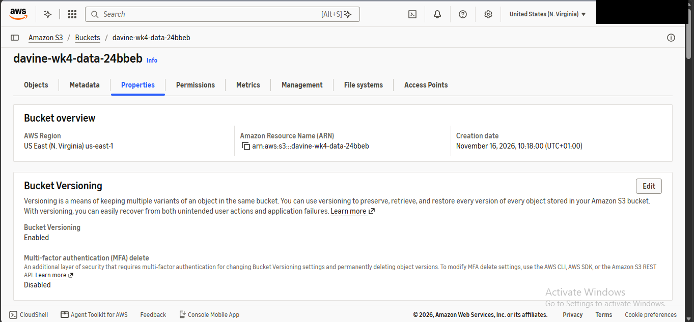

### Website, backups and databases

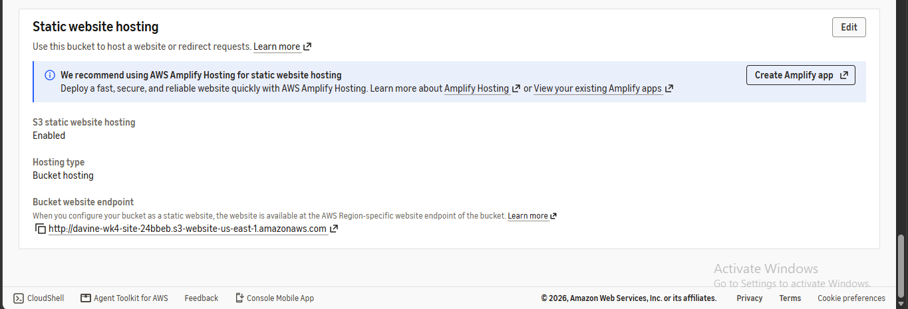

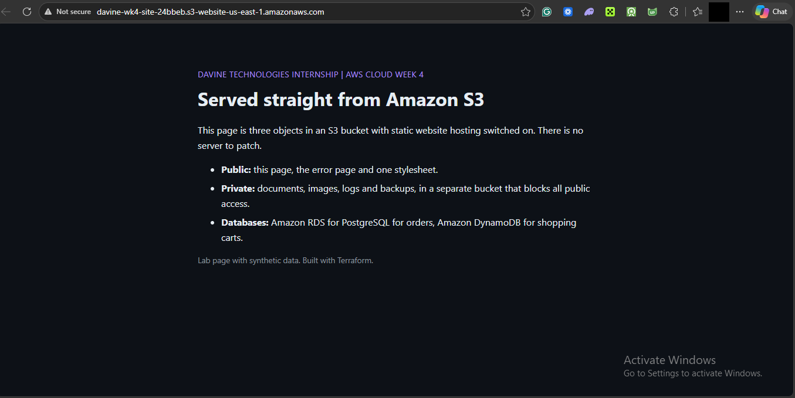

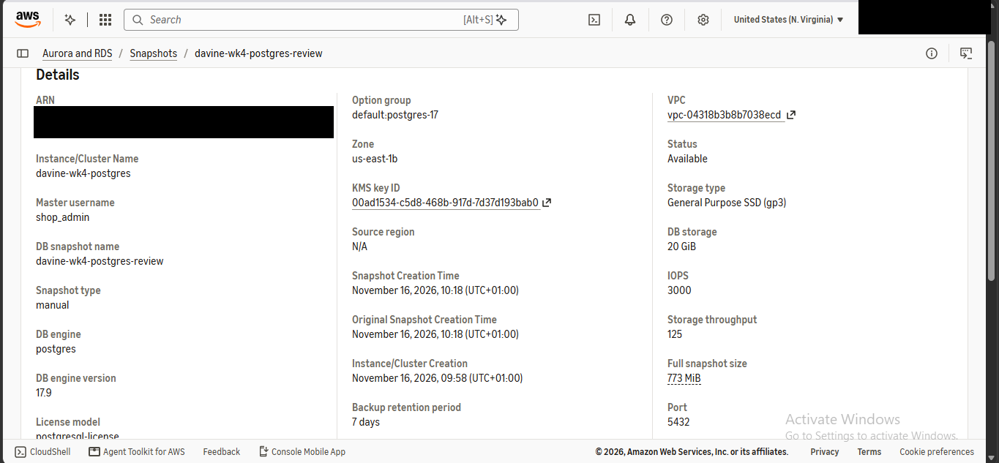

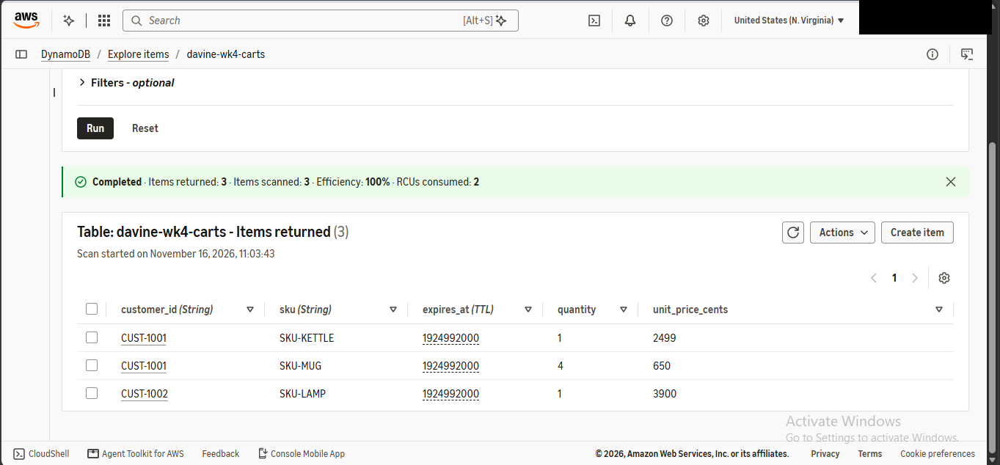

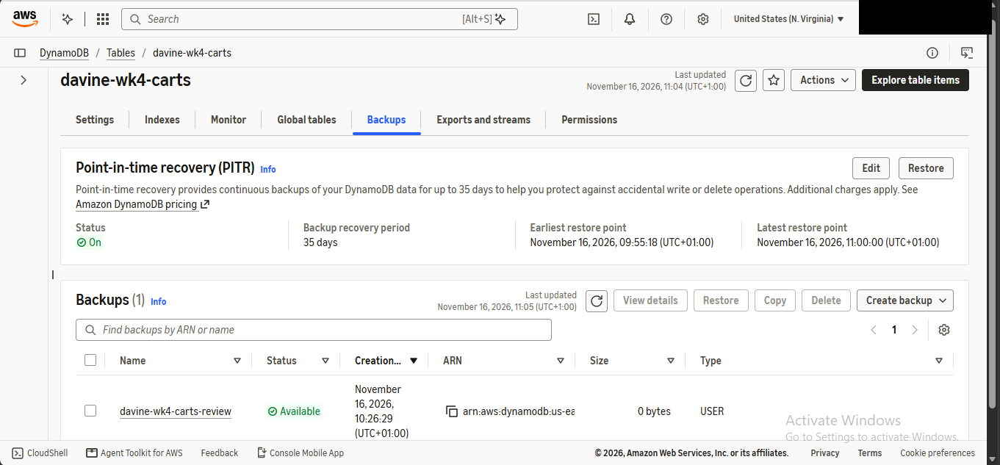

**Also:** the [buckets list](screenshots/04-s3-buckets.png), [Block Public Access off before](screenshots/02a-before-block-public-access-off.png), [versioning disabled before](screenshots/03-before-versioning-disabled.png), the website bucket's [objects](screenshots/05-site-bucket-objects.png), [properties](screenshots/06a-site-bucket-properties.png), [tags](screenshots/06c-site-bucket-tags.png) and [encryption](screenshots/06d-site-bucket-encryption.png), the [data folders](screenshots/08-data-bucket-folders.png), [Glacier Instant Retrieval](screenshots/09-backups-glacier-instant-retrieval.png), the [lifecycle rules](screenshots/12-data-lifecycle-rules.png), RDS [connectivity](screenshots/13-rds-connectivity.png) and [maintenance](screenshots/14-rds-maintenance.png), and the [DynamoDB table](screenshots/16-dynamodb-table.png). Its item count shows 0 because the console's count is refreshed about every six hours; the scan beside it returns 3.

## Mistakes I fixed

1. **DynamoDB rewrote my prices.** The sample items stored `6.50` and `39.00`. DynamoDB normalises numbers, so they came back as `6.5` and `39`, and Terraform planned to "fix" two items on every run. Prices are now whole cents (`unit_price_cents = 650`), the usual safe way to store money, and `terraform plan` reports no changes.
2. **A live check that could never pass.** It asked the AWS CLI for `ResponseMetadata.HTTPStatusCode`, a field the CLI does not print, so it read `None` on a working request. It now checks whether the request succeeded.
3. **The recovery drill uploaded from a pipe.** `aws s3api put-object --body /dev/stdin` is rejected: the CLI needs a real file. The run stopped before changing anything; the drill now writes a small temporary file. With fixes 2 and 3, the first hardened run's single failure and its stop both went away, and the rerun passed 67 of 67.
4. **One day of database backups.** My first draft kept automated backups for 1 day. Trivy flagged it; it is now 7, and Terraform rejects 0, so backups cannot be switched off by a variable.
5. **Tests that could not run at plan time.** Bucket ARNs and some rule sets are only known after `apply`, so the first test run skipped 24 of 25 tests. The policies are now built from the bucket name, the random suffix is fixed in the tests, and the route table and default security group declare their rules explicitly, which also makes Terraform remove any rule added by hand.
6. **Two scanner ignores did nothing.** My Trivy ignores for SSE-S3 sat above the bucket, but the finding is on the encryption resource, so Trivy still failed. They now sit directly above `aws_s3_bucket_server_side_encryption_configuration`.

7. **My teardown check ran too early.** It counted one RDS snapshot a minute after `destroy`, most likely the automated backup that RDS deletes by itself shortly after the instance. Nine minutes later it was gone without any action from me. The script now waits up to 10 minutes for RDS before it searches, and the [teardown transcript](docs/evidence/teardown-2026-11-16.txt) keeps both runs.
8. **A `.gitignore` template would have broken CI.** The Python template's `*.log` rule hid the sample log, so the Terraform tests would have failed on GitHub with a missing file. A rehearsal of the whole workflow on a clean copy of the publishable files caught it, and a precise exception now sits last in `.gitignore`, where it wins.

## Traps I avoided

- **A website bucket can never be the safe bucket.** S3 website hosting needs `BlockPublicPolicy` and `RestrictPublicBuckets` off, and its endpoint is HTTP only, so a TLS-only policy there would break the site. That is why the fix is a second bucket, not a tighter first one.
- **A database password in Terraform ends up in the state file.** `manage_master_user_password` makes RDS create the password and keep it in Secrets Manager instead.
- **Automated RDS backups die with the instance.** Only a manual snapshot outlives it, which is why the review asks for one.
- **Small objects in the cheaper classes cost more.** Standard-IA and Glacier Instant Retrieval bill each object as at least 128 KB, and charge for early deletion. My sample files show the mechanism; for real savings the objects must be large.
- **A versioned bucket does not empty with a plain delete.** Every version and delete marker must go first. `force_destroy` does that on `terraform destroy`, and the teardown then searches by name to confirm.

## Lab vs production

| Concern | In this module | Before going to production | Well-Architected pillar |
|---|---|---|---|
| Website delivery | S3 website endpoint, HTTP, a public bucket, because the brief asks for S3 website hosting | CloudFront with origin access control, HTTPS on a custom domain, and a fully private bucket | Security |
| Encryption keys | SSE-S3, the AWS managed `aws/rds` key, DynamoDB's AWS owned key | customer managed KMS keys with rotation and key policies, where access to the key must be audited | Security |
| Audit | none beyond the default CloudTrail event history | CloudTrail data events for S3, server access logs, IAM Access Analyzer for external access | Security |
| Database availability | single-AZ, deletion protection off, no final snapshot, so the lab can be destroyed | Multi-AZ, deletion protection on, a final snapshot on delete | Reliability |
| Backups | 7 days of RDS backups, one manual snapshot, PITR, an on-demand DynamoDB backup | an AWS Backup plan with copies to another Region or account, and scheduled restore tests | Reliability |
| Database size | db.t4g.micro serving no traffic | sized from measured load, Performance Insights and alarms on | Performance Efficiency |
| Terraform state and changes | local state, `terraform apply` from my laptop | S3 backend with locking; a pull request with the plan, applied by CI through an OIDC role | Operational Excellence |
| Cost | lifecycle rules, on-demand DynamoDB, everything tagged | budgets per account, S3 Storage Lens, cost allocation tags activated | Cost Optimization |
| Footprint | Graviton (`t4g`) database; old data moves to colder tiers | the same, plus expiry for data nobody needs | Sustainability |

## What I learned

- **One line of a bucket policy decides what is public.** `Resource: bucket/*` meant "the whole bucket", not "the website". Separating by bucket, not by prefix, is what let Block Public Access protect the rest.
- **The right service follows from how the data is used.** Files go to S3, a disk for one server is EBS, a directory shared by many is EFS. Related records with transactions go to RDS; data always read by one key goes to DynamoDB.
- **A backup counts only once a restore works.** Versioning proved itself only when a deleted file came back byte for byte; the RDS and DynamoDB restores remain untested here, and the testing record says so.
- **Writing the review as code made "before and after" honest.** The same script that found six problems in the baseline found none in the result.
- **An AI explanation is a draft.** It got the design right and four details wrong, and only running the code against AWS showed which was which.

## Sources

AWS pages used to check the report and the AI's answers: [S3 storage classes](https://aws.amazon.com/s3/storage-classes/), [Hosting a static website on S3](https://docs.aws.amazon.com/AmazonS3/latest/userguide/WebsiteHosting.html), [Blocking public access](https://docs.aws.amazon.com/AmazonS3/latest/userguide/access-control-block-public-access.html), [Security best practices for S3](https://docs.aws.amazon.com/AmazonS3/latest/userguide/security-best-practices.html), [EBS volume types](https://docs.aws.amazon.com/ebs/latest/userguide/ebs-volume-types.html), [What is Amazon EFS?](https://docs.aws.amazon.com/efs/latest/ug/whatisefs.html), [RDS backups](https://docs.aws.amazon.com/AmazonRDS/latest/UserGuide/USER_WorkingWithAutomatedBackups.html), [RDS and Secrets Manager](https://docs.aws.amazon.com/AmazonRDS/latest/UserGuide/rds-secrets-manager.html), [DynamoDB point-in-time recovery](https://docs.aws.amazon.com/amazondynamodb/latest/developerguide/Point-in-time-recovery.html).

## License

Released under the [MIT License](LICENSE). The synthetic sample data is part of this work; the Davine Technologies course material is not included.
